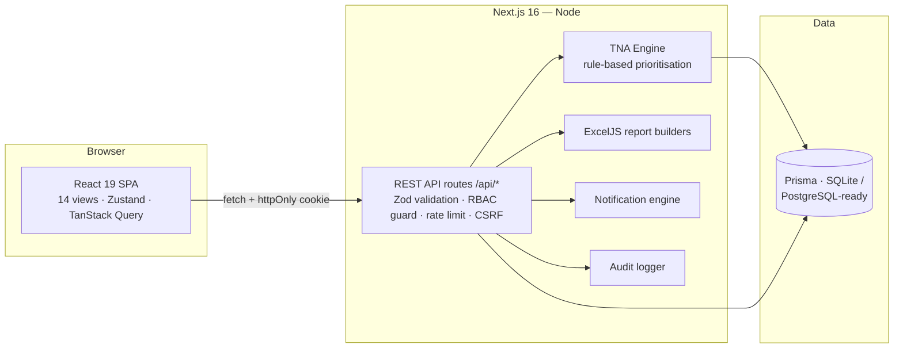
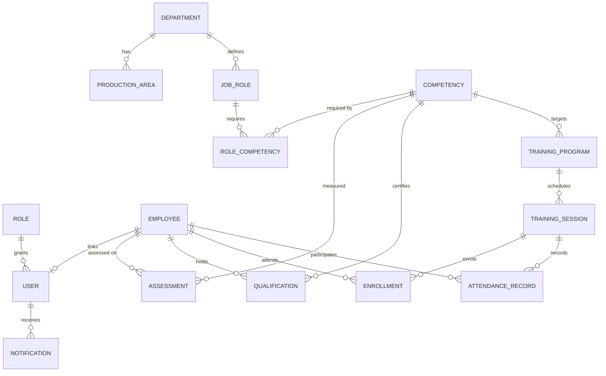
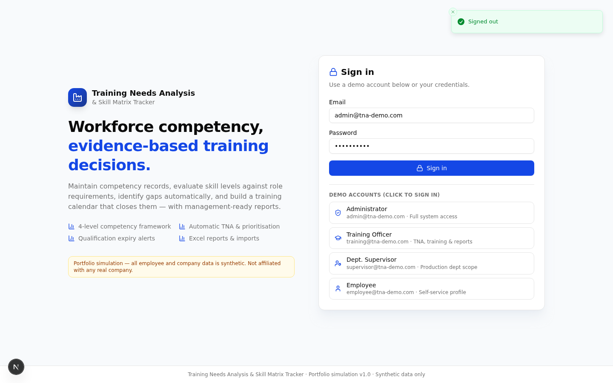
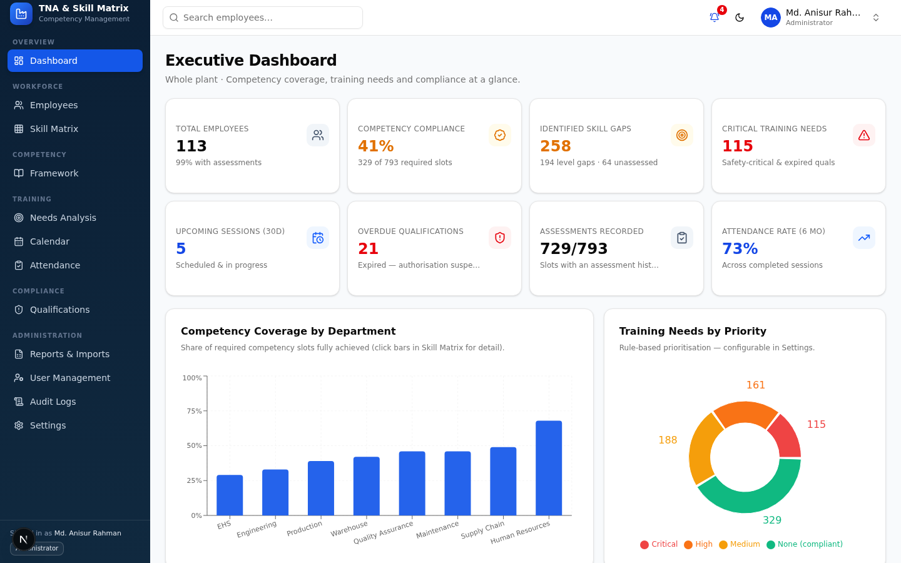
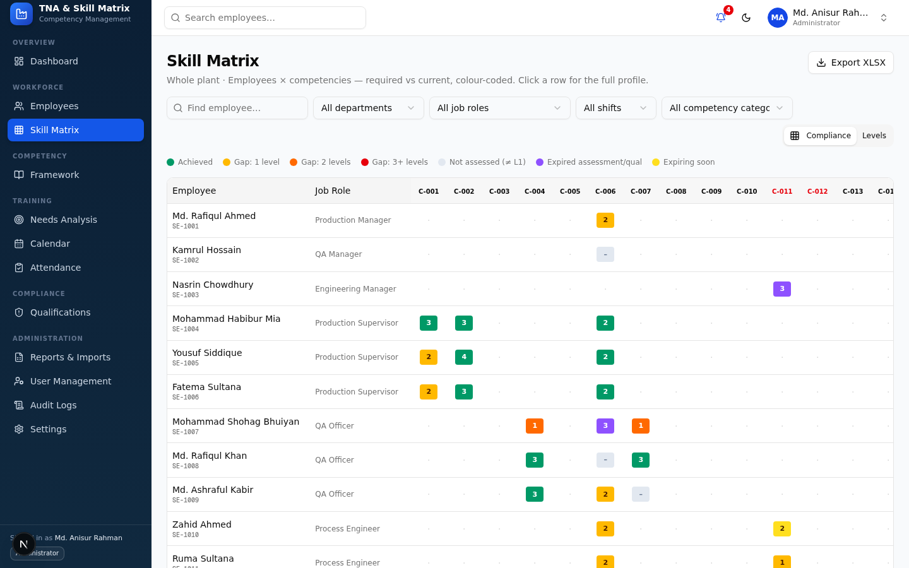
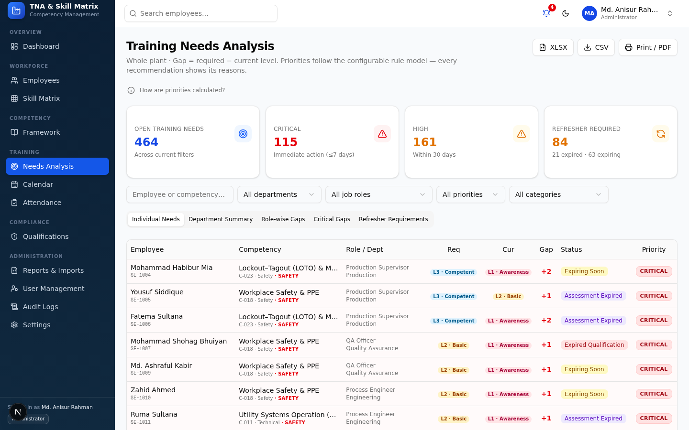
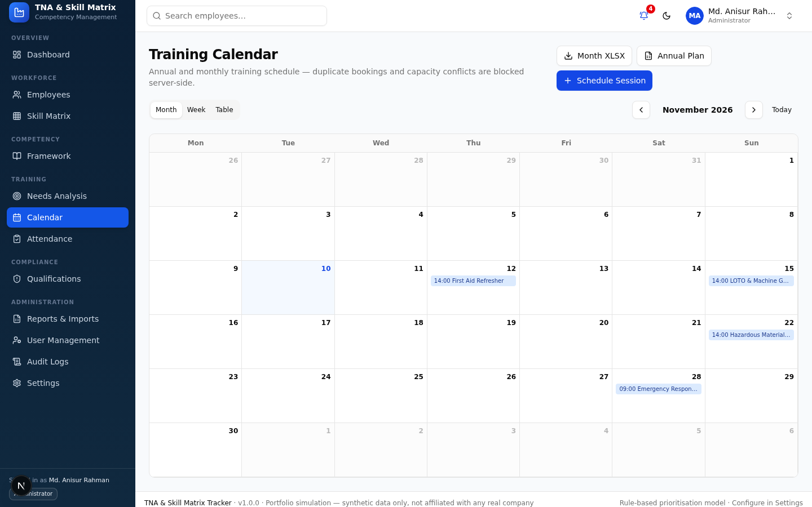
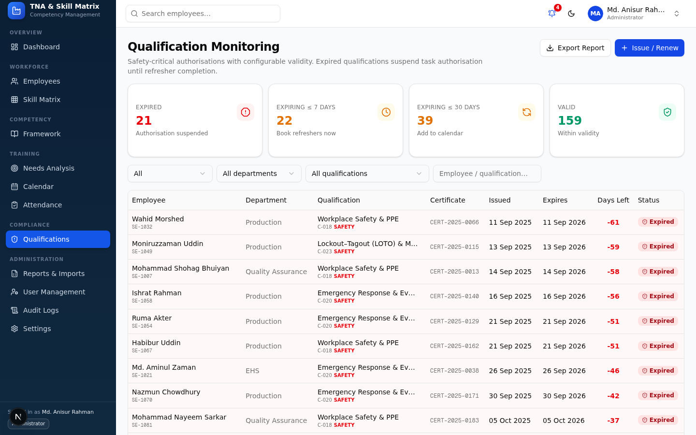
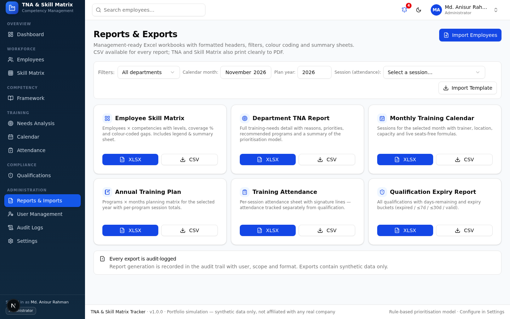
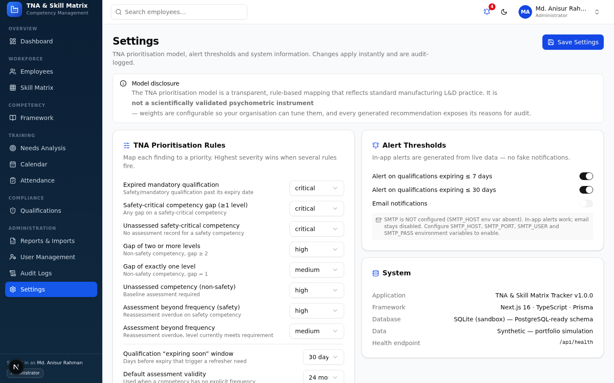

# Training Needs Analysis & Skill Matrix Tracker

**A production-grade workforce competency management system for manufacturing plants** — employee competency records, role-wise requirements, a four-level skill matrix, an automatic Training Needs Analysis (TNA) engine, training calendar, attendance tracking, qualification-expiry monitoring, and management-ready Excel reporting.

> ⚠️ **Disclaimer — Portfolio simulation.** This is an independent portfolio project simulating a manufacturing HR/L&D environment. All employees, competencies, qualifications and records are **synthetic**. This project is **not affiliated with, endorsed by, or connected to any real company** (including BAT or any other manufacturer). No real personal data is stored.

---

## 1. Overview

Manufacturing plants struggle to answer a deceptively simple question: *“Who is qualified to do what, at what level, and where are the risks?”* Spreadsheets decay, qualification expiries are missed, and training budgets are spent on the wrong people.

This application digitises the full competency lifecycle:

```
Role requirements → Assessment → Gap analysis (TNA) → Training plan → Attendance
      ↑                                                              ↓
      └────────────── Re-assessment / Qualification renewal ←────────┘
```

## 2. Business problem

| Pain point | Consequence |
|---|---|
| Competency records live in spreadsheets | Stale data, no single source of truth |
| No link between *role requirement* and *current level* | Gaps discovered only after incidents |
| Expired safety qualifications tracked manually | Compliance risk, suspended authorisations discovered late |
| Training calendars built ad-hoc | Duplicated sessions, capacity conflicts, reactive firefighting |
| TNA reports assembled manually each year | Slow, inconsistent, hard to audit |

## 3. Solution

- **Competency framework** — 28 manufacturing competencies across 6 categories, each with a 4-level scale, assessment criteria, reassessment frequency and qualification validity.
- **Role requirements matrix** — every job role maps to required competencies and levels (configurable by the Administrator).
- **Skill matrix** — interactive employees × competencies grid, colour-coded, filterable by department / role / shift / category, with per-employee coverage %.
- **TNA engine** — automatically computes `Gap = Required − Current` for every employee × required competency, then applies a **configurable rule-based prioritisation model** (expired mandatory qualification → Critical; safety-critical gap → Critical; 2-level gap → High; 1-level gap → Medium; …). Every recommendation **shows its reasons**.
- **Training calendar** — month / week / table views, duplicate & trainer-conflict detection, capacity-guarded enrolment.
- **Attendance** — present / absent / excused with a separate *qualified* flag (attendance ≠ qualification), bulk CSV upload.
- **Qualification monitoring** — expiry buckets (expired / ≤7 days / ≤30 days / valid), in-app alerts generated from live data (no fake notifications).
- **Reports** — 6 Excel workbooks (styled, colour-coded, auto-filter, summary sheets, live formulas) + CSV for every report; every export is audit-logged.

## 4. Key features

| Module | Highlights |
|---|---|
| **Employee management** | 112 synthetic employees, 8 departments, 18 production areas, 27 job roles, filters, search, pagination, add/edit |
| **Competency framework** | CRUD, safety-critical & mandatory flags, role-requirement matrix editor, level legend |
| **Skill matrix** | Compliance & Levels view modes, tooltips, per-competency coverage summary, XLSX export |
| **TNA engine** | Individual / department / role-wise / critical / refresher reports, reason strings, due dates, priority model configurable in Settings |
| **Training calendar** | Month grid, week list, table; schedule sessions; enrol with capacity checks; status workflow |
| **Attendance** | Roster editor, mark-all-present, bulk CSV, attendance % , XLSX sheet with signature lines |
| **Qualifications** | Issue / renew, expiry buckets, days-remaining, certificate refs, XLSX/CSV export |
| **Reports & imports** | 6 core reports × XLSX/CSV, employee import template, upload → validate → preview → commit flow with per-row error reporting |
| **RBAC** | 4 roles (Administrator, Training Officer, Department Supervisor, Employee), 33 permissions enforced **server-side**; supervisors are hard-scoped to their department |
| **Audit trail** | Every login (incl. failures), create/update/delete, export, import recorded with user, role, IP, timestamp |
| **Alerts** | In-app notification centre; alerts materialised from live data on demand; email stays disabled until SMTP is configured |

## 5. Technology stack

| Layer | Choice | Notes |
|---|---|---|
| Framework | **Next.js 16 (App Router)** + TypeScript 5 | Full-stack: React 19 UI + Node.js API routes |
| UI | Tailwind CSS 4, shadcn/ui (New York), Lucide icons, Recharts, Framer Motion | Light/dark theme (next-themes) |
| State | Zustand (client), TanStack Query v5 (server) | |
| Database | **Prisma ORM** — SQLite in this sandbox | Schema uses no SQLite-specific types → **portable to PostgreSQL** (see Deployment) |
| Auth | Custom credentials: scrypt password hashing + HMAC-SHA256 signed httpOnly session cookie | No third-party auth dependency |
| Excel | ExcelJS | Styled workbooks, data validation, live formulas |
| Validation | Zod on every API input | |
| Runtime | Node.js / Bun | |

> **Stack note.** The original concept targeted FastAPI + PostgreSQL. This implementation consolidates the backend into Next.js API routes (TypeScript end-to-end, single deployable) with Prisma as the ORM — the data model and REST contracts map 1:1 to the original design. A PostgreSQL migration path is documented in [`docs/DEPLOYMENT.md`](docs/DEPLOYMENT.md).

## 6. Architecture



Deep dives: [`docs/ARCHITECTURE.md`](docs/ARCHITECTURE.md) · [`docs/API.md`](docs/API.md) · [`docs/DATABASE.md`](docs/DATABASE.md)

### Repository layout

```text
├── src/app/               # SPA entry + 27 REST API route handlers
├── src/lib/               # auth, RBAC guard, Zod schemas, TNA engine, Excel builders
├── src/components/app/    # 14 application views + shell + design-system atoms
├── src/components/ui/     # shadcn/ui primitives
├── prisma/                # schema.prisma (17 models) + deterministic seed
├── docs/                  # ARCHITECTURE · API · DATABASE · DEPLOYMENT · SECURITY · TESTING + screenshots
├── sample-data/           # employee-import template (XLSX) + sample CSV
├── scripts/api-sweep.mjs  # 173-check API regression harness (bun run test:api)
├── .github/workflows/     # CI: lint + build on every push/PR
├── Dockerfile             # production container (standalone output)
├── docker-compose.yml     # app + PostgreSQL + one-command schema/seed init
└── README.md · CHANGELOG.md · CONTRIBUTING.md · LICENSE
```

## 7. Database ER diagram

17 normalised entities with foreign keys, unique constraints and indexes:



Full schema with indexes: [`docs/DATABASE.md`](docs/DATABASE.md) · source: [`prisma/schema.prisma`](prisma/schema.prisma)

## 8. Screenshots

| | |
|---|---|
|  |  |
| *Login with one-click demo accounts* | *Executive dashboard — 8 KPIs + charts* |
|  |  |
| *Interactive skill matrix (colour-coded)* | *TNA with reasons & priorities* |
|  |  |
| *Training calendar (month view)* | *Qualification expiry monitoring* |
|  |  |
| *Reports & imports* | *Configurable TNA rule model* |

More: [`docs/screenshots/`](docs/screenshots/) (17 images incl. dark mode & mobile).

## 9. Try it in 2 minutes

```bash
git clone https://github.com/<your-account>/tna-skill-matrix-tracker.git
cd tna-skill-matrix-tracker
bun install                # or: npm install / pnpm install
cp .env.example .env       # set DATABASE_URL + AUTH_SECRET
bun run db:push            # create the schema
bun run db:seed            # load the synthetic dataset + demo users
bun run dev                # → http://localhost:3000
```

No build step, no external services — SQLite keeps everything local. Sign in with any demo account from §10.

> Prefer containers or managed PostgreSQL? A one-command `docker-compose.yml` stack (app + Postgres + schema/seed init) and full production steps are in [`docs/DEPLOYMENT.md`](docs/DEPLOYMENT.md).

## 10. Demo logins

| Role | Email | Password | Scope |
|---|---|---|---|
| Administrator | `admin@tna-demo.com` | `Admin@1234` | Whole plant, users, settings, audit |
| Training Officer | `training@tna-demo.com` | `Training@1234` | Whole plant, TNA, training, reports |
| Dept. Supervisor | `supervisor@tna-demo.com` | `Supervisor@1234` | **Production department only** |
| Employee | `employee@tna-demo.com` | `Employee@1234` | Own profile & training only |

The login screen offers one-click sign-in for each role. Permissions are enforced **server-side** — try `GET /api/users` as the supervisor (403) or open another department's employee profile.

## 11. Synthetic dataset

Generated by a **deterministic seeded PRNG** (`prisma/seed.ts`) — identical on every run:

| Entity | Count | Entity | Count |
|---|---|---|---|
| Departments | 8 | Employees | 112+ |
| Production areas | 18 | Assessments | 728 |
| Job roles | 27 | Qualifications | 241 (21 expired · 22 ≤7d · 39 ≤30d) |
| Competencies | 28 | Training programs | 16 |
| Role requirements | 180 | Training sessions | 58 (10 months of history + upcoming) |

Sample extracts: [`sample-data/employees-sample.csv`](sample-data/employees-sample.csv) · [`sample-data/employee-import-template.xlsx`](sample-data/employee-import-template.xlsx)

## 12. Installation

```bash
# 1. Install dependencies
bun install            # or: npm install

# 2. Configure environment
cp .env.example .env   # then edit DATABASE_URL + AUTH_SECRET

# 3. Create the database schema
bun run db:push

# 4. Seed the synthetic dataset (users, employees, competencies, history)
bun run db:seed

# 5. Start
bun run dev            # http://localhost:3000
```

Scripts: `dev` · `lint` (ESLint) · `db:push` · `db:seed` · `db:generate` · `build` · `start`

## 13. API documentation

27 REST endpoints under `/api` — full reference with request/response shapes: [`docs/API.md`](docs/API.md). Highlights:

```
POST /api/auth/login               GET  /api/dashboard
GET  /api/employees                POST /api/employees
GET  /api/employees/:id            GET  /api/skill-matrix
GET  /api/tna?scope=critical       POST /api/assessments
GET  /api/training/sessions        POST /api/training/sessions/:id/enroll
PUT  /api/attendance               POST /api/qualifications
GET  /api/reports/:type?format=    POST /api/import/preview
GET  /api/audit-logs               PUT  /api/settings
```

## 14. Testing & verification results

**API functional verification — 10/10 scenarios PASS** (executed against the running app on 2026-11-10; details in [`docs/TESTING.md`](docs/TESTING.md)):

| # | Scenario | Result |
|---|---|---|
| 1 | L1 current vs L3 required → 2-level gap → **High** (non-safety); any safety gap → **Critical** | ✅ PASS |
| 2 | Achieved competency → compliant, no training need | ✅ PASS |
| 3 | Unassessed competency → explicit *Not Assessed* (never treated as L1) | ✅ PASS |
| 4 | Expired mandatory qualification → **Critical**, authorisation suspended message | ✅ PASS |
| 5 | Qualification expiring soon → refresher need with due date = expiry | ✅ PASS |
| 6 | Duplicate enrolment skipped; capacity breach → **409** with seat count | ✅ PASS |
| 7 | Supervisor cross-department access → **403**; dept filter force-overridden | ✅ PASS |
| 8 | Invalid import rows (dup code, bad dept/role/date/status, existing code) → per-row errors, valid rows pass | ✅ PASS |
| 9 | Attendance save (3 records) + non-enrolled rejection → **400** | ✅ PASS |
| 10 | TNA XLSX (2 sheets) / Skill-matrix CSV (28 competency columns) generated | ✅ PASS |

**Browser E2E (headless Chromium)**: all 14 views render and function, RBAC-aware navigation, notification refresh from live data, dark mode, mobile 390px layout, sticky-footer behaviour verified in both short- and long-page cases, **zero page errors**. One layout defect (footer pushed 41px below viewport on short pages) was found and fixed during verification.

**Regression harness (2026-11-11 hardening pass) — 173/173 checks PASS** via `bun run test:api` ([`scripts/api-sweep.mjs`](scripts/api-sweep.mjs)):

| Suite | Coverage | Checks |
|---|---|---|
| AUTH | login (4 roles, Bearer + cookie tracks), forged tokens, CSRF, rate limiting, logout | 16 |
| RBAC | 19 endpoints × 4 roles status matrix | 76 |
| SCOPE | employee self-only data, supervisor dept-only, cross-dept denials | 9 |
| DATA | seed contracts (112 employees / 28 competencies / 16 programs / 58 sessions / 241 quals), pagination, filters | 12 |
| RULE | gap = required − current, not-assessed ≠ L1, TNA priorities, expiry buckets 21/22/39/159 | 5 |
| CRUD | employee/competency/assessment/program/session/enrollment/attendance/qualification/user/settings/notification lifecycles with validation + teardown | 34 |
| IMPORT/REPORT/AUDIT | template, preview, 10 report formats (xlsx+csv), audit trail actions | 21 |

Bugs found & fixed in this pass: attendance-bulk 500 on non-form bodies (→ 400), four routes whose in-route 403s were silently swallowed into `200 {}` by the response wrapper (RBAC hardening), calendar session-detail attendance badge never rendering (type bug), "Record Attendance" button never showing for past sessions (type bug), React-Query cache not isolated between user sessions (Providers key bug), 11 TypeScript strict-mode errors, Radix dialog a11y warnings. Login rate limit retuned 10 → 20 per 5 min for demo account switching. Database self-healing (auto-seed when empty at boot, on login, and on health probes) verified against total-wipe and server-restart scenarios.

**Static quality**: `eslint .` → 0 errors, 0 warnings; `tsc --noEmit` → 0 app errors.

## 15. Deployment

- **Local / demo**: `bun run dev` with SQLite (`db/custom.db`) — zero external services.
- **Production**: [`docs/DEPLOYMENT.md`](docs/DEPLOYMENT.md) covers Vercel + managed PostgreSQL (Supabase/Neon) and Docker — including a `docker-compose.yml` stack (app + Postgres + one-command schema/seed init), environment variables, health checks and backup guidance.
- **CI**: `.github/workflows/ci.yml` runs ESLint + a production build on every push and pull request.

## 16. Security

| Control | Implementation |
|---|---|
| Password storage | scrypt KDF, per-user salt, timing-safe comparison |
| Sessions | HMAC-SHA256 signed token, httpOnly + SameSite=Lax cookie, 8h expiry, server-side revocation on disable |
| RBAC | 33 permissions × 4 roles, checked on **every** API route server-side; department scoping for supervisors |
| CSRF | SameSite cookies + custom-header requirement on mutations |
| Rate limiting | Login: 20 req / 5 min / IP; imports: 20/min; global per-route buckets (in-memory) |
| Injection | Prisma parameterised queries; Zod schema validation on all inputs |
| XSS | React auto-escaping; no `dangerouslySetInnerHTML` |
| Secrets | `.env` git-ignored; `.env.example` documents variables; production fails closed without `AUTH_SECRET` |
| Audit | Logins (incl. failures), all mutations, exports & imports with IP + timestamp |

Details: [`docs/SECURITY.md`](docs/SECURITY.md)

## 17. Known limitations

1. **In-memory rate limiting & notification cache** — single-instance only; use Redis for horizontal scaling.
2. **SQLite in the sandbox** — fine for demo scale (112 employees, ~2k records); switch to PostgreSQL for production concurrency.
3. **No automated test suite in-repo** — verification was scripted/manual (documented above); unit tests are the top future improvement.
4. **Email notifications disabled by design** — in-app alerts work; SMTP requires env configuration (the UI shows this honestly).
5. **Import updates are not supported** — the import flow creates new employees only (documented in the wizard).
6. **TNA model is rule-based, not validated** — weights are configurable and disclosed in-app; it is not a psychometric instrument.
7. **Single-session user model** — no concurrent-session management UI.

## 18. Future improvements

- Automated test suite (Vitest unit + Playwright E2E) wired into CI
- PostgreSQL + Redis deployment template (docker-compose)
- Assessment approval workflow (supervisor → training officer sign-off)
- 9-box / succession analytics; cost-per-gap budgeting on the TNA
- Email digests via cron worker once SMTP is configured
- Multi-plant support with plant-level scoping
- SCORM/e-learning integration for online program completion

## License

MIT — see [`LICENSE`](LICENSE).

---

*Built as an independent portfolio project to demonstrate Training & Development, TNA, manufacturing HR and digital-transformation competency. All data is synthetic.*
